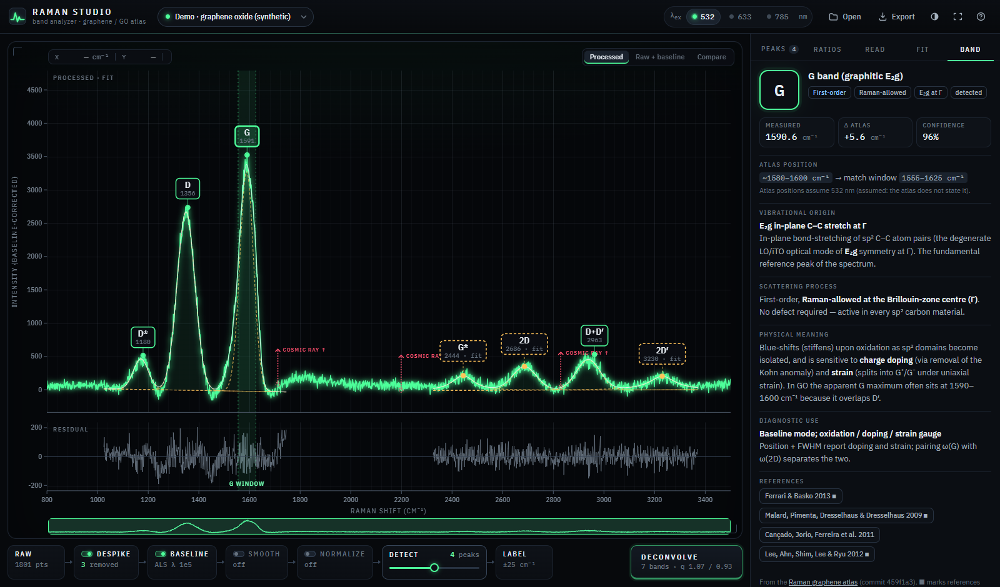
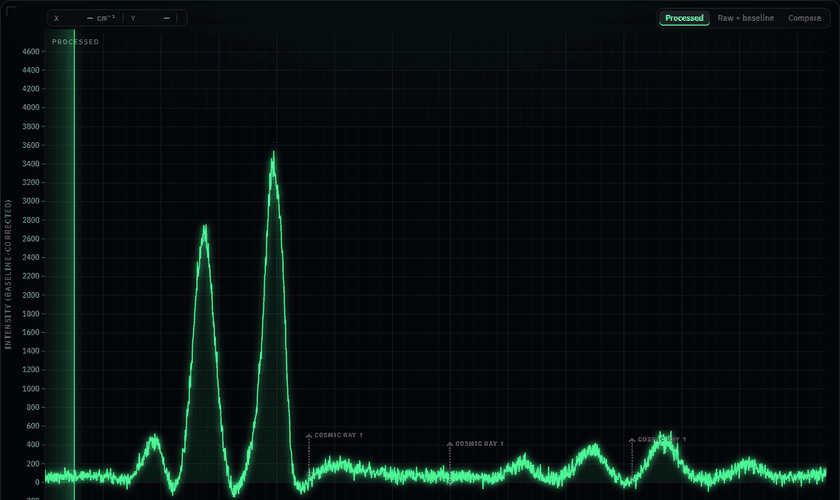

# Raman Studio

Drop in a Raman spectrum (Excel, CSV, TXT, JCAMP-DX or SPC, whatever the instrument
exports) and see it immediately, cleaned up, with every peak labelled from the
[Raman graphene / graphene-oxide atlas](https://vascoesquivel.github.io/raman-graphene-atlas/).
Click a label to read what the band means, get the atlas intensity ratios from your own
numbers, and resolve the shoulders hidden inside broad GO bands with a nine-band fit.

**Live:** https://vascoesquivel.github.io/raman-studio/
· try it with no file: [graphene-oxide sample](https://vascoesquivel.github.io/raman-studio/?sample=go),
[monolayer sample](https://vascoesquivel.github.io/raman-studio/?sample=mono)



<p align="center"></p>

Everything runs in your browser. Files are parsed locally and never uploaded. The
app is static files on GitHub Pages: no server, no account, no build step.

## Using it

1. **Load** a file: drag it onto the window, press <kbd>O</kbd>, or use a sample.
   Several files, sheets or intensity columns load as separate spectra. Switch
   between them from the name chip, or show them overlaid or stacked. If the app
   can't tell which column is the Raman shift, it shows a small column-mapping
   preview instead of failing.
2. **Clean** with the signal chain under the plot. Each module has its own switch:
   - **Despike** removes 1–3 point cosmic-ray spikes (modified z-score plus a
     width test, so real bands are never touched). Removed spikes are marked on
     the plot.
   - **Baseline**: constant, linear or quadratic, as in PeakForge, or asymmetric
     least squares for curved fluorescence.
   - **Smooth**: optional Savitzky–Golay.
   - **Normalize**: to the maximum, to the G band, or to unit area.

   *Raw + baseline* (<kbd>B</kbd>) and *Compare* (<kbd>C</kbd>) show what each step
   did.
3. **Detect.** Peaks are found by prominence (a port of SciPy's `find_peaks`), not
   naive local maxima. The **sensitivity** slider sets the prominence threshold as a
   multiple of the measured noise.
4. **Label.** Each peak is matched to the atlas band whose window contains it, with
   a confidence that falls off with distance from the atlas centre:
   - Unmatched peaks stay on the plot as **unassigned**.
   - Peaks in the 2850–2920 cm⁻¹ window are tagged **sp³ C–H**, which the atlas
     says is not a lattice band.
   - Pick the excitation laser (532 / 633 / 785 nm). D and 2D windows shift with
     it at the atlas rates (~50 and ~100 cm⁻¹/eV).
5. **Deconvolve** (<kbd>F</kbd>). This seeds PeakForge's Levenberg–Marquardt fitter
   with the atlas nine-band model and fits the first- and second-order regions.
   Bands it resolves get dashed callouts, so you can tell them apart from the
   solid callouts of detected maxima. The Fit tab shows residuals, fit quality
   against the noise floor, uncertainties and degeneracy warnings.
6. **Explain.**
   - Click any label to see the band's vibrational origin, scattering process,
     diagnostic use and references, all taken from the atlas.
   - **Ratios** computes the atlas ratio guide (height and area versions), with
     the Cançado crystallite size and Eckmann defect class.
   - **Read** walks the atlas's "read your own spectrum" steps using your numbers.
7. **Export:**
   - The figure as PNG (3×) or SVG, on white, with labels and legend.
   - CSV files of the peak table, the fit parameters and the processed spectrum.
   - A one-page printable report: figure, tables, ratios and interpretation.
   - A project JSON (<kbd>Ctrl</kbd>+<kbd>S</kbd>) that reopens exactly where you
     left off.

**Presentation mode** (<kbd>P</kbd>) goes fullscreen with large type and projector
contrast. <kbd>←</kbd> <kbd>→</kbd> step through the labels with a caption for each band.
<kbd>T</kbd> switches between the dark and light themes. <kbd>?</kbd> lists every shortcut.

### Keyboard

Keys follow PeakForge where the action exists there.

| key | action |
|---|---|
| <kbd>O</kbd> | open file |
| <kbd>D</kbd> | detect and label again (replays the scan) |
| <kbd>F</kbd> | deconvolve (PeakForge: auto-fit) |
| <kbd>1</kbd> <kbd>2</kbd> <kbd>3</kbd> | laser 532 / 633 / 785 nm |
| double-click plot | add a peak by hand (PeakForge: add peak) |
| <kbd>Del</kbd> | remove the selected peak (PeakForge: delete curve) |
| <kbd>←</kbd> <kbd>→</kbd> | nudge the selected peak (<kbd>Shift</kbd> = 10×) |
| <kbd>[</kbd> <kbd>]</kbd> | previous / next label |
| <kbd>Ctrl</kbd>+<kbd>Z</kbd> / <kbd>Ctrl</kbd>+<kbd>Y</kbd> | undo / redo |
| <kbd>Ctrl</kbd>+<kbd>S</kbd> | save project |
| wheel · drag · <kbd>Shift</kbd>+drag | zoom · pan · zoom to range |
| <kbd>R</kbd> | show the whole spectrum |
| <kbd>B</kbd> / <kbd>C</kbd> | raw + baseline / compare raw and processed |
| <kbd>P</kbd> / <kbd>T</kbd> | presentation mode / theme |
| <kbd>Esc</kbd> | deselect, close, leave presentation |

## Supported formats

| format | notes |
|---|---|
| `.csv` `.tsv` `.txt` `.dat` `.asc` | Any delimiter (comma, semicolon, tab, pipe, spaces) and decimal commas. Header and comment lines are skipped. UTF-8, UTF-16 or Windows-1252. Handles Renishaw WiRE and Horiba LabSpec exports (descending x, `#Laser` headers), several intensity columns, transposed tables and long map exports (X, Y, Wave, Intensity). |
| `.xlsx` `.xls` | Every sheet with numeric data. Read with SheetJS 0.20.3, loaded from its CDN only when a spreadsheet is opened. |
| `.jdx` `.dx` | JCAMP-DX 4.24 / 5: `XYDATA` with AFFN or ASDF compression (SQZ, DIF, DUP), `XYPOINTS`, `PEAK TABLE`, multi-block files. |
| `.spc` | Thermo / Galactic SPC, new format. Even and XY spacing, single and multiple subfiles. Experimental. |

The wavenumber column is detected automatically: monotonic, roughly 50–4000 cm⁻¹,
evenly spaced, and helped by header names. An index column never wins.

## Adding a band library

Band data lives in `data/libraries/`. The app loads every file listed in
`data/libraries/index.json`; GitHub Pages can't list folders, so the manifest is
needed. To add a material:

1. Write `data/libraries/<material>.json` following
   [`data/libraries/schema.json`](data/libraries/schema.json). Use
   `graphene-go.json` as a worked example. Each band needs `id`, `label`, `name`,
   `region` (`first` / `second`), `posText`, `posSort` and a `match` block:
   `range` [lo, hi] in cm⁻¹, `center`, and `dispersion.cmPerEV` (`0` for
   non-dispersive, `null` if unknown). The descriptive fields (`origin`,
   `process`, `mechanism`, `meaning`, `diagnostics`, `use`, `correction`, `refs`)
   fill the explanation panel.
2. Add `{ "file": "<material>.json" }` to `index.json`.
3. Pick it in the **Label** module of the signal chain.

Ratios and the read-your-spectrum evaluation are optional (`ratios`, `ratioMap`,
`workflow`). The automatic workflow evaluation is written for the graphene
library; other libraries show their steps as text.

`graphene-go.json` is **generated** from the atlas, so don't edit it by hand:

```
python tools/extract_atlas.py path/to/raman-graphene-atlas/index.html --commit <sha>
python tools/verify_atlas.py            # field-by-field diff against the atlas on GitHub
```

## Development

No build step. Serve the folder the way GitHub Pages does (under a subpath) and open it:

```
python tools/serve.py          # http://127.0.0.1:8765/raman-studio/
```

Tests run in a real browser. `tests/index.html` runs the unit suites (parsers,
cosmic-ray filter, baselines, SciPy-checked peak detection, the fitter, atlas
matching, ratios, workflow and label layout) using synthetic spectra and one small
fixture per format. To run everything headless:

```
pip install playwright          # drives your installed Chrome or Edge
python tools/run_tests.py       # unit tests
python tools/check_app.py       # end-to-end: samples, every fixture, exports, screenshots
```

Lab files for local testing go in `test-data/private/`, which is gitignored.
Module contracts are in [`docs/ARCHITECTURE.md`](docs/ARCHITECTURE.md).

## Credits

- **Band data:** the [Raman Spectroscopy of Graphene & Graphene Oxide atlas](https://vascoesquivel.github.io/raman-graphene-atlas/)
  ([source](https://github.com/VascoEsquivel/raman-graphene-atlas)), its nine-band
  model, ratio guide, decision workflow and references, used verbatim.
- **Fitting:** [PeakForge / Curve-gen](https://vascoesquivel.github.io/Curve-gen/)
  ([source](https://github.com/VascoEsquivel/Curve-gen)), its WiRE-compatible
  pseudo-Voigt profile and Levenberg–Marquardt fitter with trust bounds and
  uncertainties.
- Peak detection follows SciPy's `find_peaks`. Despiking follows Whitaker & Hayes
  (2018). The ALS baseline follows Eilers & Boelens (2005). The polynomial baseline
  follows Lieber & Mahadevan-Jansen (2003).
- [SheetJS](https://sheetjs.com) for spreadsheets. IBM Plex type via Google Fonts.

## Known limitations

- **Reference excitation is assumed.** The atlas doesn't say which laser its
  positions are for. The app treats them as 532 nm and labels that as an
  assumption everywhere it matters.
- **Only D and 2D shift with the laser.** Those are the only rates the atlas
  gives (~50 and ~100 cm⁻¹/eV). The windows for D′, G\*, D+D′ and 2D′ widen at
  633/785 nm instead of shifting, so matches there are looser.
- **Overlapped bands are not uniquely determined.** In GO, D′ under G and D″
  between D and G are often degenerate with their neighbours. The Fit tab flags
  them (not significant, or a near-degenerate pair) rather than hiding the
  problem. The fit always uses the fixed nine-band model with schematic seed
  widths, stops at 300 iterations, and runs on the main thread (about 0.5 s for
  a typical spectrum, longer for very dense data).
- **The automatic reading is a guide, not a verdict.** Only numeric thresholds
  the atlas states are applied, such as 2D FWHM < 30 cm⁻¹ and I_2D/I_G ≥ 2.
  "Strong D", "little D" and "broad" have no atlas numbers, so the app shows the
  measured values for you to judge. It also doesn't count 2D components (to tell
  a monolayer from a bilayer). The evaluation is written for the graphene
  library only.
- **Confidence is a distance score, not a probability.** It is
  exp(−2(d/d_max)²) of the distance from the atlas centre within the match
  window.
- **Formats are tested against synthetic fixtures.** The fixtures are modelled
  on WiRE, LabSpec, Excel, JCAMP-DX and SPC exports, not against files from
  your instruments yet (put some in `test-data/private/`). SPC support covers
  the new format only and is experimental. Wavelength (nm) x-axes are not
  converted to Raman shift.
- **Cosmic-ray removal** handles spikes up to 3 points wide. Wider bursts, or a
  spike on a band narrower than about 5 points, are left alone.
- **Multiple spectra** are compared visually (overlay or stacked). Processing,
  labels, ratios and exports apply to the spectrum currently selected; there is
  no batch export yet.
- **Online dependencies:** SheetJS is fetched from its CDN the first time a
  spreadsheet is opened, and IBM Plex comes from Google Fonts (system fonts are
  used if they can't load). Your data is never sent anywhere.
- **Demo spectra are synthetic.** They are generated from atlas positions and
  marked as such, not measurements.
